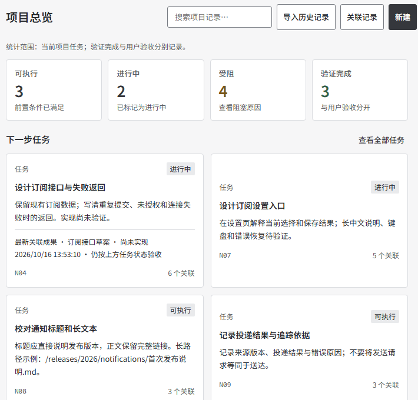
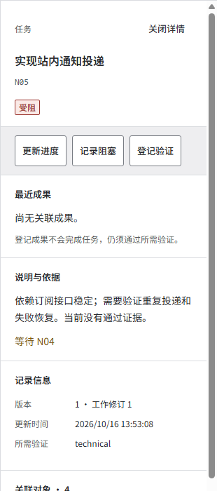
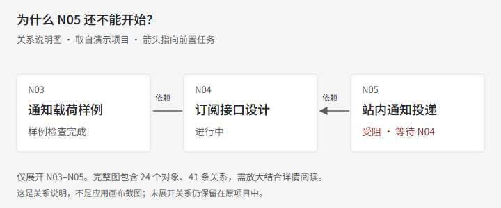
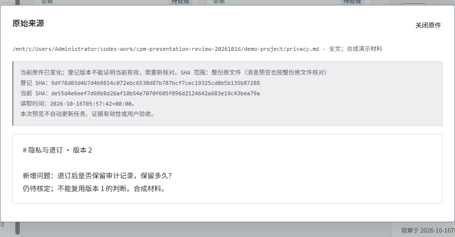

# Codex Project Manager

[MIT](LICENSE) · [v0.1.0-alpha.3](https://github.com/Cottzz/codex-project-manager/releases/tag/v0.1.0-alpha.3) · [Windows checks](https://github.com/Cottzz/codex-project-manager/actions/workflows/checks.yml)

### Keep your Codex project moving across conversations.

Pick up the next task without reconstructing the plan from old chats. Keep dependencies, decisions, evidence and chat references in one local workspace—and know what still needs a human decision.

[简体中文](README.zh-CN.md) · [Try the example](#try-the-example) · [Use your own project](#use-your-own-project) · [Documentation](docs/user-guide.md)

[](docs/presentation/overview-full.png)

*The actual white workspace UI, using the included synthetic release-notification project. UI text is Simplified Chinese. Open the image for the full workspace.*

[Watch the short walkthrough](docs/presentation/walkthrough.mp4) · [Follow the same story](docs/presentation/story.md)

[Download video](https://github.com/Cottzz/codex-project-manager/releases/download/v0.1.0-alpha.3/walkthrough.mp4) · [English captions](docs/presentation/walkthrough.en.vtt) · [中文配套字幕](docs/presentation/walkthrough.zh.vtt)

## When the work outgrows a chat

You have a plan in one conversation, an implementation in another, and a review in a third. Before continuing, you need to find the next eligible task, understand what blocks it, and check which evidence is still current.

Codex Project Manager keeps those records on disk. The browser, CLI and MCP use the same project state. Records must be explicitly added or synchronized; it does not automatically capture every conversation or take control of a running desktop chat.

It is useful for work that spans conversations and requires traceable decisions. A single question or a short personal checklist may not need it.

## Three ways to move the project forward

### 1. Find the next task—and its prerequisites

Open the task board, select the work, and read its dependencies, required checks and original content. “In progress,” “waiting for validation,” and “waiting for a human” remain different states.

[](docs/presentation/tasks-full.png)

### 2. Explain what is blocked

Follow an explicit dependency to its prerequisite. The diagram below explains N03–N05 only; it is not a screenshot of the graph canvas. The graph helps locate related work; it does not prove unrecorded relationships do not exist. Large fit-all graphs may need zoom and object details.

[](docs/presentation/graph-full.png)

### 3. Return to the evidence before accepting a result

Open the original file and compare its registered and current version. A changed source needs review. A generated file or completed chat does not automatically complete a task or approve a release.

[](docs/presentation/source-full.png)

The example includes 16 tasks across 3 phases, explicit dependencies, actual sample files, uncertain checks and a pending human gate. The first 3 completions concern sample-file checks only—not implemented business features. [Read the scenario and expected states](docs/presentation/story.md).

## Try the example

**Requirements:** Python 3.11+ and macOS or Linux. On Windows, use Ubuntu WSL; the core service requires Unix file locks. Core project management uses the Python standard library. No model account is required for this example. The bundled Simplified Chinese font is OFL-licensed.

From a terminal:

```sh
git clone https://github.com/Cottzz/codex-project-manager.git
cd codex-project-manager
python3 examples/create_walkthrough.py "$HOME/cpm-notification-demo"
python3 pgw.py --root "$HOME/cpm-notification-demo" serve --port 8767
```

Open **http://127.0.0.1:8767/**. Select **任务看板** (task board), open **N05**, then read why it waits for **N04**. Next, open **证据与判断** (evidence), select **E04**, and choose **查看原始来源** (read original source) to see the changed file version.

The example refuses an existing directory. Choose a new path instead of overwriting it. Keep the terminal running; Ctrl-C stops the server. Re-run only the last command to resume. The example does not invoke Codex, send a notification, or approve the pending gate.

## Use your own project

Keep the application checkout separate from the project you manage. Choose an existing project directory and initialize it **once**, only if it is not already attached:

```sh
python3 /absolute/codex-project-manager/pgw.py --root /absolute/my-project init --name "My project" --goal "Ship a verified result"
python3 /absolute/codex-project-manager/pgw.py --root /absolute/my-project serve --port 8766
```

Open **http://127.0.0.1:8766/** and confirm the project name before making changes. Initialization creates an empty state store; it does not import verified history from your files or chats. Existing initialized projects need only the serve command. If the port is occupied, use another port; do not stop an unrelated service.

Project state lives under your chosen directory’s `.project-graph/`. Evidence files remain at their original locations. [Backup and recovery](docs/data-and-recovery.md).

## Work from the CLI or MCP

```sh
python3 /absolute/codex-project-manager/pgw.py --root /absolute/my-project call project_status
python3 /absolute/codex-project-manager/pgw.py --root /absolute/my-project call current_frontier
python3 /absolute/codex-project-manager/pgw.py tools
```

Use the returned schemas for writes. Updates preserve project identity, request IDs and version checks; human approvals stay explicit. [MCP configuration](docs/integrations.md).

## Optional connections and current boundaries

| Capability | Scope |
|---|---|
| Existing Codex chats | Discover, preview and link with a configured Codex CLI; no shared control of an active desktop chat. |
| Workspace-managed chats | Separate App Server sessions; exact requests and human approvals are required. |
| Code relationships | Optional deterministic index; static candidates, bounded queries and explicit unknowns. [Setup](docs/code-index.md). |
| Multiple projects | Each project has independent persistent state; confirm the selected project before writing. |
| Local use | One trusted local user, loopback service; no hosted multi-user access control. |

This is a public **alpha**, not an official OpenAI product. Complete accessibility, sustained reading comfort and long-duration memory behavior are not fully established. See [known limits](docs/limitations.md) and [version-bound verification](docs/validation.md). CI badges cover the checks named in their workflow, not every capability.

## Learn, report, contribute

[User guide](docs/user-guide.md) · [Architecture](docs/architecture.md) · [Roadmap](docs/roadmap.md) · [Contribution guide](CONTRIBUTING.md) · [Report a bug](https://github.com/Cottzz/codex-project-manager/issues/new/choose) · [Security](SECURITY.md)

[MIT](LICENSE) for application code; third-party components retain their licenses. [Third-party notices](docs/third-party.md).
