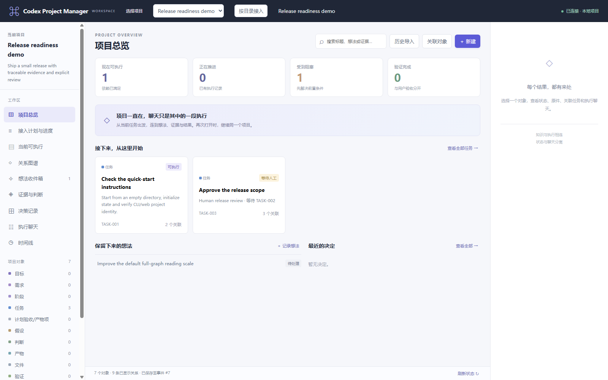

# Codex Project Manager

**面向 Codex 与 AI 编码协作的本地项目管理工作区。**

将任务、依赖、决定、证据、产物和聊天关联保存在同一个持久项目图中，让项目能够跨对话接续。聊天摘要用于定位，实际原件与验证决定状态。

[下载 alpha](https://github.com/Cottzz/codex-project-manager/releases/tag/v0.1.0-alpha.1) · [English](README.md) · [使用说明](docs/user-guide.md) · [架构](docs/architecture.md) · [路线图](docs/roadmap.md)



上图为当前应用的合成示例。A白系新版界面仍在完整原型审核，未作为已发布界面宣传。

## 它解决什么问题

当一个Codex项目持续多个对话时，你需要知道：现在能执行什么、被什么阻塞、哪些依据已经变化、成果和原件在哪里。工作区用本地状态回答这些问题，并提供网页、CLI和MCP入口。

这是独立社区工具，不是OpenAI官方产品。它没有代码编辑器、托管团队权限或自动批准机制。

## 快速开始

需要Python 3.11+及macOS/Linux。Windows用户可使用Ubuntu WSL；核心服务依赖Unix文件锁，不支持原生Windows。基础项目管理只依赖Python标准库，Codex与代码解析器为可选依赖。

```sh
git clone https://github.com/Cottzz/codex-project-manager.git
cd codex-project-manager
python3 pgw.py --root "$PWD" init --name "我的项目" --goal "交付有依据且可验证的成果"
python3 pgw.py --root "$PWD" serve --port 8766
```

打开http://127.0.0.1:8766/。终端保持运行，Ctrl-C停止，再次运行serve接续。不重复初始化已有项目。端口被占用时使用其他端口。

先体验合成示例：

```sh
python3 scripts/create_demo.py /tmp/cpm-demo
python3 pgw.py --root /tmp/cpm-demo serve --port 8767
```

示例包含任务、依赖、证据和人工门禁，不启动Codex、不发送消息、不代替人工决定。

## 能力与入口

- 通过任务前沿核对执行前置；任务完成与技术验证、用户验收分别记录。
- 按明确目录接入多个项目，状态与操作身份隔离。
- 用来源定位、SHA与版本记录证据和成果；变化后重核受影响验证。
- 查询有界关系图、静态代码候选和上下文；动态及图外关系不假定已知。
- 发现和关联已有Codex聊天；受管聊天采用独立App Server连接。
- CLI与网页读取同一追加事件日志，MCP使用相同工具合同。

```sh
python3 pgw.py --root /项目绝对路径 call project_status
python3 pgw.py --root /项目绝对路径 call current_frontier
python3 pgw.py tools
```

写入须稳定request_id；版本更新须expected_version。冲突先回读，不能强制覆盖。准确人工请求只能由用户作决定。

## 适用范围

首个公开版本为alpha。[验证范围](docs/validation.md)与[已知限制](docs/limitations.md)如实列明。桌面聊天发现不等于共享控制；聊天结束不等于任务完成；原全图适应画布仍有小字限制；长期内存、连续使用舒适度和完整读屏没有全面通过证据。

本地服务只监听回环地址，采用单个可信用户假设；没有多用户远程权限系统，不应直接暴露到互联网。项目数据保存在你指定目录；可选Codex、MCP、SSH使用独立配置和明确操作。

[集成配置](docs/integrations.md) · [代码索引](docs/code-index.md) · [数据与恢复](docs/data-and-recovery.md) · [参与贡献](CONTRIBUTING.md) · [MIT许可](LICENSE)
