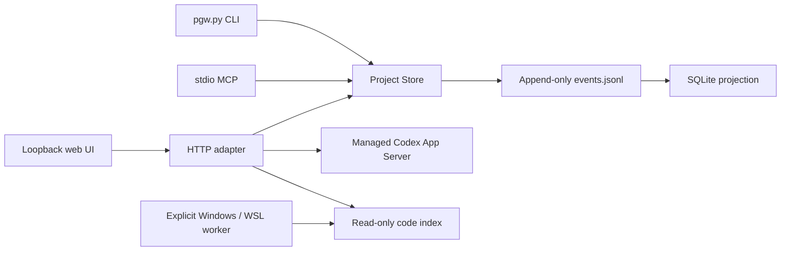

# Architecture

`service.py` owns tasks, relationships, versions, validation freshness and human gates. `workspace.py` routes explicit project identities. `pgw.py` exposes the CLI, HTTP and MCP adapters. `codex_bridge.py` handles bounded read-only chat discovery; `runtime.py` owns separately managed App Server connections. `code_index.py` reads a derived cache.

The append-only event log is authoritative. SQLite is a rebuildable projection. Code caches do not own task state. A chat belongs to an execution observation; it is not the project itself. Only the hard prerequisite projection must be acyclic; knowledge relationships may contain cycles.
