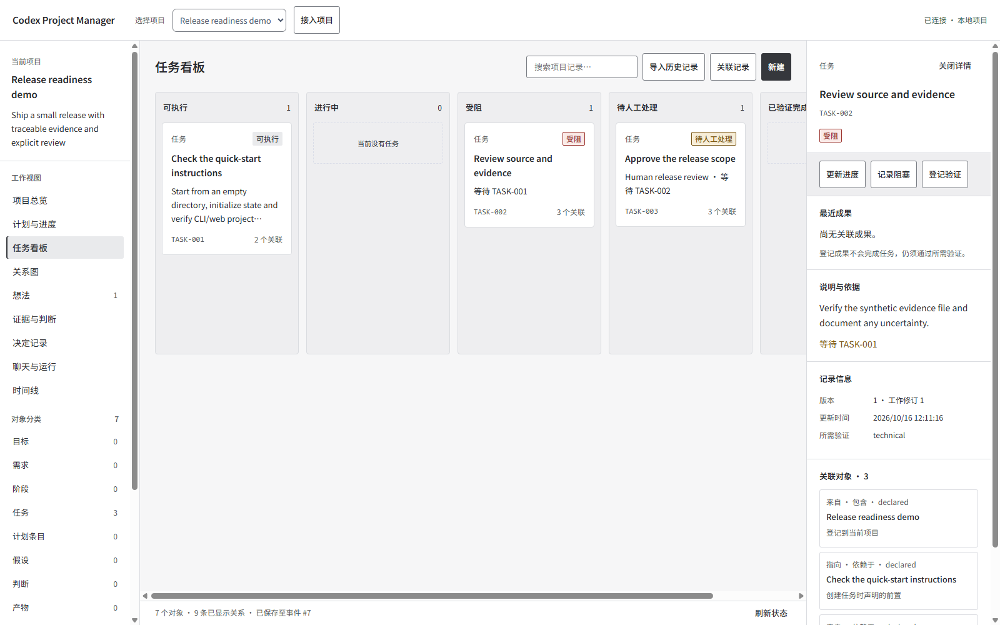
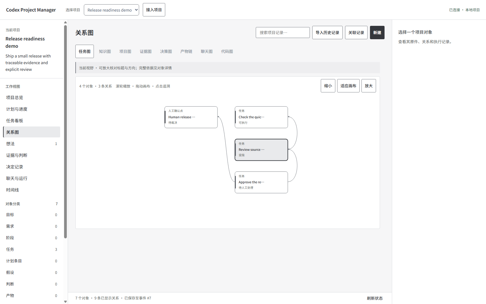
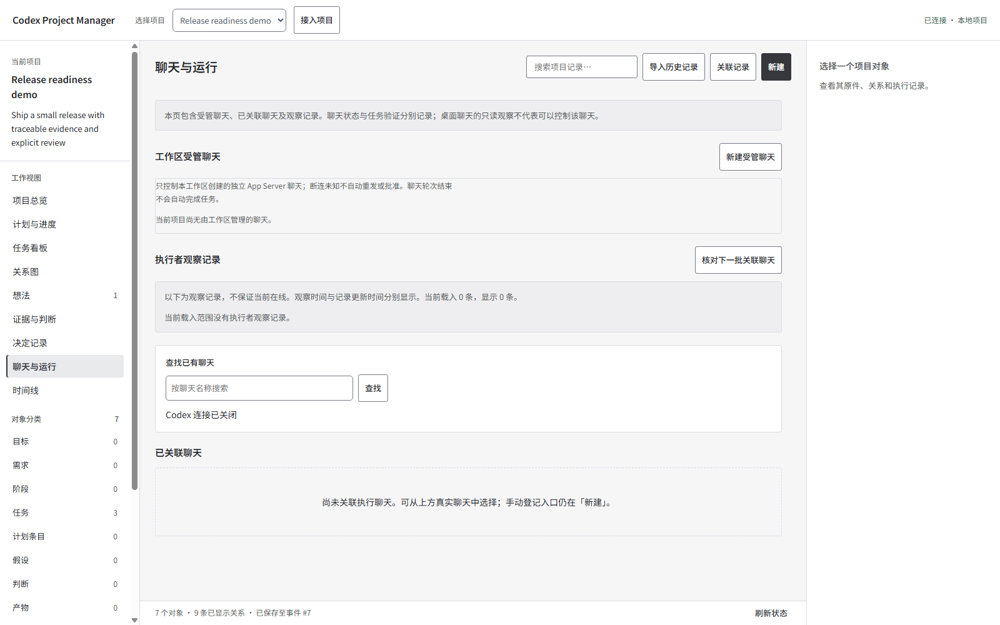
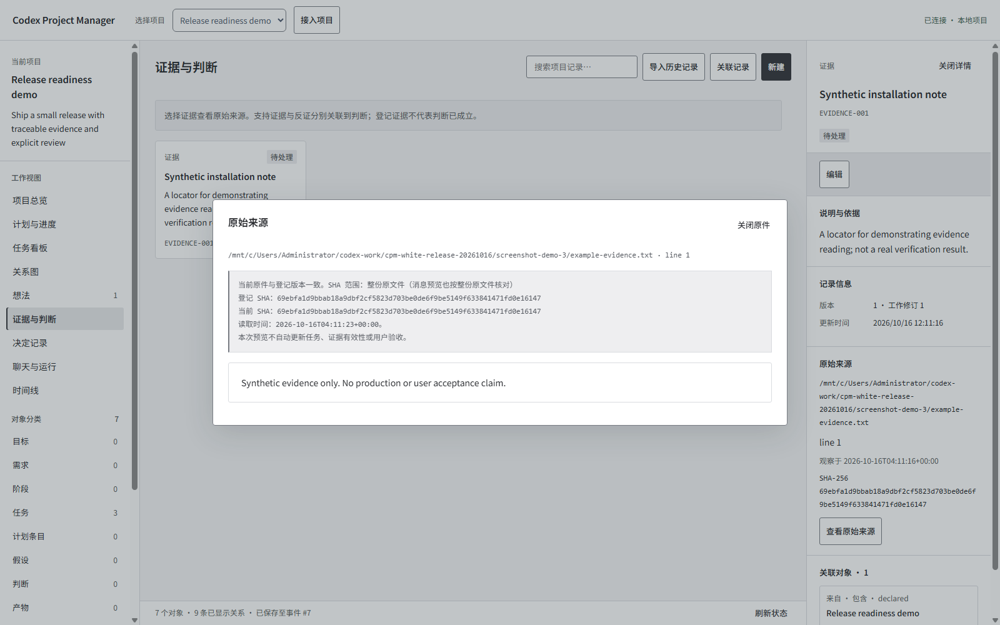

# Five workflows in the released UI

For the current 16-task notification example and recording, see the [connected walkthrough](presentation/story.md). The smaller installation example below remains available through `scripts/create_demo.py`.

These images come from the actual Python service and synthetic data generated by the included demo script. They show the same interface shipped in the download; they are not design mockups. UI text is Simplified Chinese. Optional Codex connectivity is unavailable in this controlled check; no model or real approval is invoked.

## 1. Understand the current project

Read the project identity, task counts and next eligible work. Counts distinguish validated completion from human acceptance.

## 2. Find work and inspect dependencies

The board keeps blocked work visible. Select a task to read its original content, preconditions and available actions.

## 3. Follow relationships and code scope

The graph displays explicit dependencies; its code view requires a separately configured index. Missing coverage is shown rather than invented. Fit-all may make labels small; use zoom and details.

## 4. Read chat and runtime status

Existing chat references and separately managed runtime are distinct. This example has no connected Codex runtime. Actual pending approvals identify their exact request and must be decided by a person.

## 5. Return to the source

Read the original file, locator and hash freshness. Viewing evidence does not validate a task or approve a release.

For actions and setup see [User guide](user-guide.md), [Integrations](integrations.md), and [Known limits](limitations.md).
